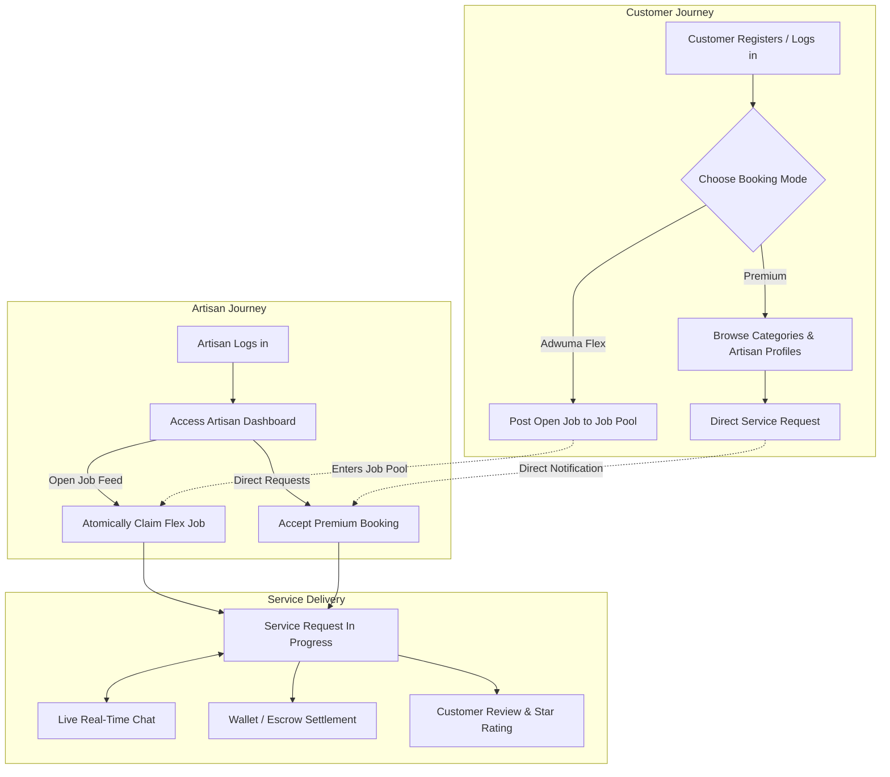

# Adwuma (Artisan Work) 🛠️

**Adwuma** (Akan/Twi for *"work"* or *"labor"*) is a full-stack, on-demand service marketplace designed to connect everyday customers and businesses with vetted, reliable, and skilled artisans and trade professionals.

From urgent domestic repairs to large-scale commercial, industrial, and specialized professional services, Adwuma removes the guesswork from hiring local technicians through transparent pricing, verified portfolios, real-time communication, and secure transactions.

---

## 📑 Table of Contents

- [Key Features](#-key-features)
- [How It Works](#-how-it-works)
- [Architecture & Tech Stack](#-architecture--tech-stack)
- [Project Structure](#-project-structure)
- [Database & Data Model](#-database--data-model)
- [Getting Started](#-getting-started)
  - [Prerequisites](#prerequisites)
  - [1. Database Setup](#1-database-setup)
  - [2. Backend Setup](#2-backend-setup)
  - [3. Frontend Setup](#3-frontend-setup)
- [Environment Variables](#-environment-variables)
- [Security & Concurrency](#-security--concurrency)
- [API Reference](#-api-reference)

---

## 🌟 Key Features

### 1. Dual Service Matching Models
- **Adwuma Flex (Job Pool)**: Customers broadcast an open request specifying the required service, problem description, location, schedule, and budget (fixed amount or open to quotes). Vetted providers in the area can inspect the job pool and claim the task.
- **Premium (Direct Booking)**: Customers browse curated service categories and artisan profiles, evaluate bios, completed job counts, ratings, and portfolios, and directly hire a specific artisan.

### 2. Concurrency-Safe Atomic Job Claiming
- Prevents race conditions when multiple artisans attempt to accept the same open flex job simultaneously using a PostgreSQL compare-and-swap function (`claim_request`). Exactly one provider wins, moving the job status to `in_progress`.

### 3. Real-Time Chat System
- Every service request has a dedicated real-time chat channel powered by Supabase Realtime websockets, allowing instant communication between customer and artisan.

### 4. Digital Wallet & Transaction Ledger
- Integrated wallet module for customers and artisans.
- Supports top-ups (e.g. Mobile Money), transaction history logging, escrow holds, releases upon job completion, and provider payouts.

### 5. Verified Artisan Profiles & Onboarding Pipeline
- Dedicated provider dashboard for tracking incoming jobs, earnings, and updating profile information (skills, bio, starting rates, experience, and portfolio images).
- Customers can apply for provider status with verification proof, subject to administrative review and approval.

### 6. Ratings, Reviews & Support
- Verified post-job reviews with 1–5 star ratings and feedback that automatically update the artisan’s overall rating via database triggers.
- Built-in support ticket and complaints system for dispute resolution.

---

## 🔄 How It Works



---

## 💻 Architecture & Tech Stack

### Frontend
- **Framework**: [React 19](https://react.dev/) with [Vite](https://vitejs.dev/)
- **Routing**: [React Router v7](https://reactrouter.com/)
- **Styling**: Modular CSS design system with CSS custom properties, responsive layouts, and dark mode-friendly palette
- **State & Realtime**: React Context API (`AuthContext`, `ToastContext`), Supabase JS Client

### Backend
- **Runtime**: Node.js (ES Modules)
- **Framework**: [Express 5](https://expressjs.com/)
- **Authentication & Data Layer**: Supabase Admin SDK (`@supabase/supabase-js`)
- **Middleware**: Custom JWT authentication and RBAC (`requireAuth`, `requireAdmin`)
- **Key Backend Responsibilities**: Secure sign-up/sign-in flows, provider verification review pipeline, administrative role management

### Database & Cloud Services
- **Platform**: [Supabase](https://supabase.com/) (PostgreSQL 15+)
- **Security**: Granular Row Level Security (RLS) on all public tables
- **Realtime**: Postgres CDC (`supabase_realtime`) for instant chat messages and notifications
- **Automation**: PL/pgSQL database triggers for automated profile creation, wallet initialization, and average rating recalculation

---

## 📁 Project Structure

```text
artisan_work/
├── backend/
│   ├── .env.example              # Sample environment variables
│   ├── package.json              # Backend dependencies and scripts
│   ├── server.js                 # Express application entrypoint
│   └── src/
│       ├── lib/
│       │   └── supabase.js       # Supabase service role & anon client setup
│       ├── middleware/
│       │   └── auth.js           # JWT authentication and admin verification
│       └── routes/
│           └── auth.js           # Auth routes & provider verification API
│
├── frontend/
│   ├── index.html                # Vite HTML shell
│   ├── package.json              # Frontend dependencies and scripts
│   ├── vite.config.js            # Vite build configuration
│   ├── supabase/
│   │   ├── schema.sql            # Main database schema & RLS policies
│   │   └── job_pool.sql          # Job pool visibility & atomic claim procedure
│   └── src/
│       ├── App.jsx               # Route definitions & global providers
│       ├── main.jsx              # Application bootstrap
│       ├── assets/               # Branding icons, hero images, category portraits
│       ├── components/           # Reusable UI components (Navbar, Footer, Cards, Modals)
│       ├── context/              # AuthContext and ToastContext
│       ├── lib/                  # Supabase API client & fetch wrappers
│       ├── pages/                # App views (Homepage, Dashboards, Chat, Wallet, etc.)
│       └── styles/               # Modular CSS stylesheets
│
└── README.md                     # Project documentation
```

---

## 🗄️ Database & Data Model

The database schema includes the following tables:

| Table | Purpose |
| :--- | :--- |
| `public.profiles` | User profiles extending Supabase `auth.users` with contact info, avatar, role (`customer` \| `provider`), and saved locations. |
| `public.artisan_profiles` | Professional profiles: category (`Domestic`, `Commercial`, `Industrial`, `Professional`), subcategory, service area, starting price, years of experience, rating, verified status, and portfolio images. |
| `public.service_requests` | Service orders supporting `flex` and `premium` types, budget types (`open` \| `fixed`), status tracking (`pending`, `in_progress`, `completed`, `cancelled`), and scheduling. |
| `public.messages` | Real-time chat messages between customer and artisan tied to a specific request ID. |
| `public.wallets` | Digital wallet account for each user to track current balances. |
| `public.wallet_transactions` | Ledger of financial movements (`deposit`, `withdrawal`, `escrow_hold`, `escrow_release`, `payout`). |
| `public.reviews` | Customer ratings (1 to 5 stars) and feedback, restricted to one review per completed request. |
| `public.support_tickets` | Customer support complaints and dispute tracking. |
| `public.notifications` | Real-time notifications dispatched to users for job updates, messages, or confirmations. |
| `public.provider_requests` | Verification application requests submitted by customers aspiring to become verified service providers. |

---

## 🚀 Getting Started

### Prerequisites
- [Node.js](https://nodejs.org/) (v18.11.0 or higher recommended)
- [npm](https://www.npmjs.com/) or [pnpm](https://pnpm.io/)
- A free [Supabase](https://supabase.com/) account and project

---

### 1. Database Setup

1. Open your Supabase project dashboard.
2. Navigate to the **SQL Editor**.
3. Run the schema script located at:
   ```text
   frontend/supabase/schema.sql
   ```
4. Run the atomic claiming and job pool script located at:
   ```text
   frontend/supabase/job_pool.sql
   ```
5. Ensure Realtime is enabled in your Supabase project for `messages`, `notifications`, and `service_requests`.

---

### 2. Backend Setup

1. Navigate to the backend directory:
   ```bash
   cd backend
   ```
2. Install dependencies:
   ```bash
   npm install
   ```
3. Create your `.env` configuration:
   ```bash
   cp .env.example .env
   ```
   Fill in your Supabase credentials:
   ```env
   SUPABASE_URL=https://your-project.supabase.co
   SUPABASE_ANON_KEY=your-supabase-anon-key
   SUPABASE_SERVICE_ROLE_KEY=your-supabase-service-role-key
   PORT=3001
   ```
4. Start the backend development server:
   ```bash
   npm start
   ```
   The backend will be live at `http://localhost:3001`.

---

### 3. Frontend Setup

1. Open a new terminal and navigate to the frontend directory:
   ```bash
   cd frontend
   ```
2. Install dependencies:
   ```bash
   npm install
   ```
3. Create your `.env` file in the `frontend/` directory:
   ```env
   VITE_SUPABASE_URL=https://your-project.supabase.co
   VITE_SUPABASE_ANON_KEY=your-supabase-anon-key
   VITE_API_URL=http://localhost:3001
   ```
4. Start the Vite development server:
   ```bash
   npm run dev
   ```
5. Open your browser and navigate to `http://localhost:5173`.

---

## 🔑 Environment Variables

### Backend (`backend/.env`)

| Variable | Description |
| :--- | :--- |
| `SUPABASE_URL` | Your Supabase project URL (e.g., `https://xyz.supabase.co`) |
| `SUPABASE_ANON_KEY` | Public Supabase anonymous API key |
| `SUPABASE_SERVICE_ROLE_KEY` | Supabase service-role secret key (used for administrative operations) |
| `PORT` | Port for the Express server (default: `3001`) |

### Frontend (`frontend/.env`)

| Variable | Description |
| :--- | :--- |
| `VITE_SUPABASE_URL` | Your Supabase project URL |
| `VITE_SUPABASE_ANON_KEY` | Public Supabase anonymous API key |
| `VITE_API_URL` | URL of the running backend Express API (default: `http://localhost:3001`) |

---

## 🔒 Security & Concurrency

- **Row Level Security (RLS)**: Public tables have strict RLS policies ensuring customers and artisans can only view and mutate their own data or jobs in which they are active participants.
- **Service Role Isolation**: High-privilege administrative functions (such as user role stamping and verification approval) are handled exclusively on the Express backend via the `SUPABASE_SERVICE_ROLE_KEY`.
- **Atomic Compare-and-Swap**: Job claiming in `frontend/supabase/job_pool.sql` executes via a `SECURITY DEFINER` function with row-level locks, guaranteeing zero double-acceptances when multiple artisans claim a flex request concurrently.

---

## 📡 API Reference

The backend Express service exposes the following endpoints:

| Method | Endpoint | Auth Required | Description |
| :--- | :--- | :--- | :--- |
| `GET` | `/api/health` | No | Health check returning status `ok` |
| `POST` | `/api/auth/signup` | No | Registers user with email, password, and role |
| `POST` | `/api/auth/signin` | No | Authenticates user with credentials |
| `POST` | `/api/auth/signout` | Yes | Terminates current session |
| `GET` | `/api/auth/me` | Yes | Retrieves current user metadata and profile |
| `POST` | `/api/auth/provider-request` | Yes | Submits proof for provider status upgrade |
| `GET` | `/api/auth/provider-requests` | Admin | Lists pending provider verification applications |
| `POST` | `/api/auth/provider-requests/:id/approve` | Admin | Approves provider request and stamps role |
| `POST` | `/api/auth/provider-requests/:id/reject` | Admin | Rejects provider request |
| `PATCH` | `/api/auth/role` | Admin | Directly modifies user role |

---

## 📄 License

This project is licensed under the [ISC License](LICENSE).
